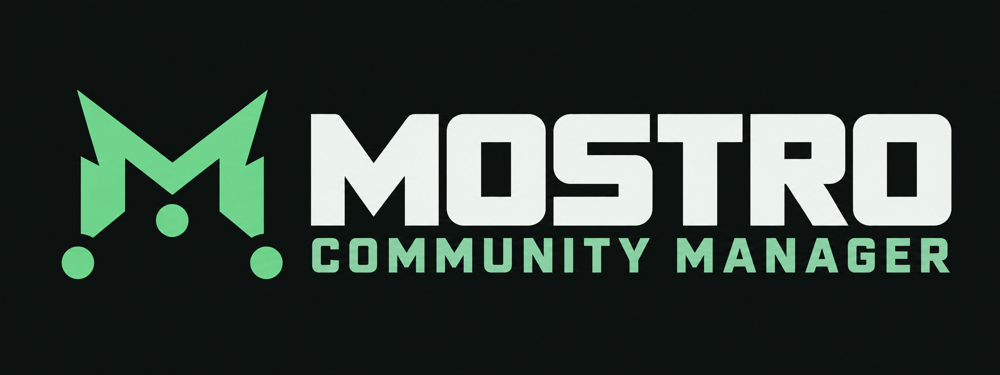

# Tienda comunitaria de Umbrel: Mostro Community Manager

Tienda comunitaria de Umbrel con una sola aplicación: **Mostro Community Manager**, el panel para operar el nodo Mostro P2P de una comunidad. **Versión del manifiesto de Umbrel: 1.0.16.**

El código, la documentación y los reportes de errores están en [ManDeBitcoin/mostro-community-manager](https://github.com/ManDeBitcoin/mostro-community-manager). Este repositorio solo tiene lo que Umbrel necesita, porque Umbrel lo clona entero en cada equipo.

## Instalar en Umbrel

1. En Umbrel, abrir **App Store → Community App Stores / Tiendas comunitarias**.
2. Añadir `https://github.com/ManDeBitcoin/mostro-community-umbrel`.
3. Instalar **Mostro Community Manager**.
4. Comprobar que la ficha muestre **1.0.16** y abrirlo desde Umbrel.

ID estable de la aplicación: `mandebitcoin-mostro-manager`. Puerto del panel: `5173`, gestionado por `app_proxy`. Depende de la app Lightning de Umbrel.

## Contenido

| Ruta | Para qué |
| --- | --- |
| `umbrel-app-store.yml` | Identifica la tienda (`id: mandebitcoin`) |
| `mandebitcoin-mostro-manager/` | Manifiesto (`umbrel-app.yml`) y `docker-compose.yml` de la app |
| `assets/`, `docs/screenshots/` | Ícono e imágenes de la ficha |
| `.github/workflows/store-guard.yml` | Comprueba en cada push que la versión anunciada tenga una imagen pública para amd64 y arm64 |
| `scripts/release_metadata.py`, `scripts/verify-public-image.py` | Herramientas que usa `publish.yml` del repositorio de código para promover una versión |

Las versiones las promueve automáticamente el workflow de publicación del repositorio de código, con un PR a este repositorio, solo cuando la imagen ya es pública. Ver [el proceso de publicación](https://github.com/ManDeBitcoin/mostro-community-manager/blob/main/docs/release-process.md).

## Licencia

Copyright (C) 2026 Man De Bitcoin. GPL-3.0-or-later; ver [LICENSE](LICENSE).
